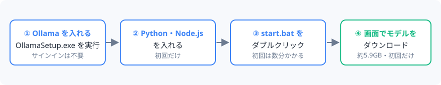
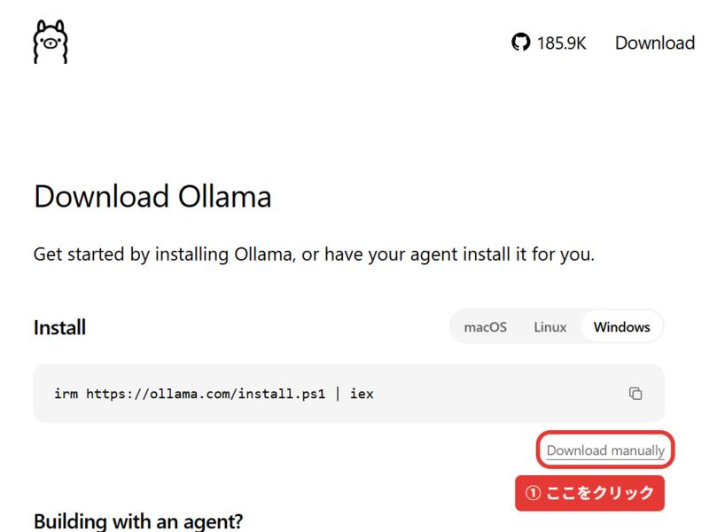
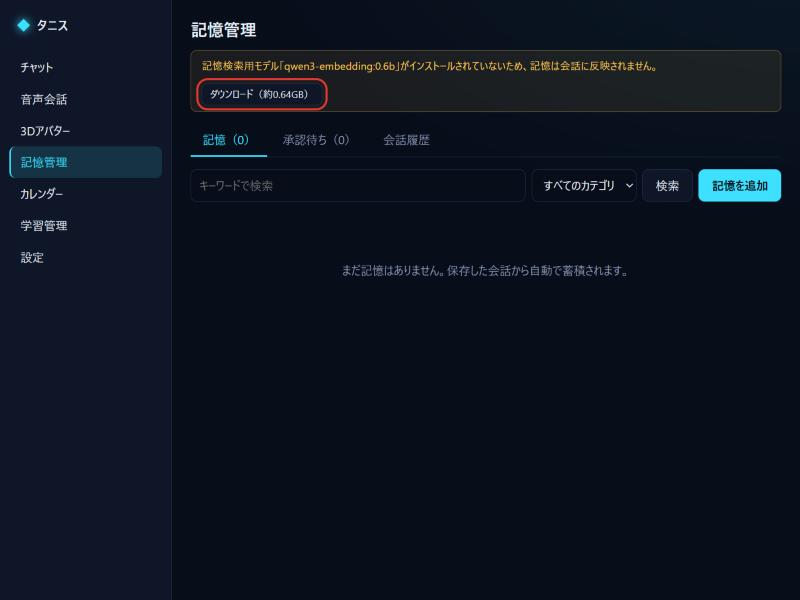
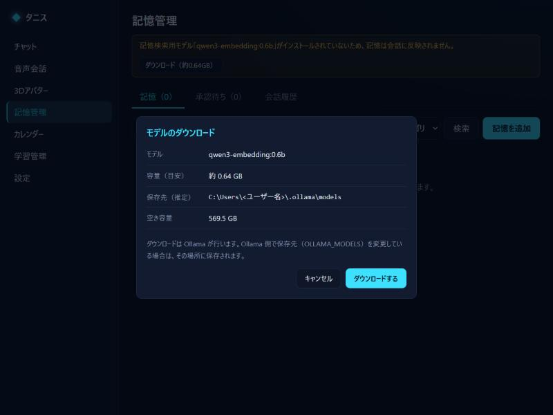

# TanisJr
生成AIの共同制作用リポジトリー！！

## 第二の自分AI（Personal Twin AI）

あなたの性格・価値観・話し方を理解し、ときには根拠を示して反論してくれる「第二の自分」となるローカルAIです。
AIの処理はすべてこのPC上（Ollama）で行い、有料APIは使いません。

- 設計: [docs/ARCHITECTURE.md](docs/ARCHITECTURE.md)
- 進捗・今後の予定: [docs/PROGRESS.md](docs/PROGRESS.md)

> **現在の状態: Phase 5（追加学習）まで実装済み。** すべての画面が利用できます。

## 必要なもの

| ソフトウェア | バージョン（動作確認済み） | 入手先 |
|---|---|---|
| Windows | 11 | |
| Python | 3.12 以降（3.14.5 で確認） | https://www.python.org/ |
| Node.js | 20 以降（24.19 で確認） | https://nodejs.org/ |
| Ollama | 0.40.13 で確認 | https://ollama.com/download |
| GPU | NVIDIA RTX 5060 8GB で確認（GPUなしでもCPUで動作、ただし低速） | |

## はじめかた（はじめての人向け・詳しい手順）



### ステップ1: Ollama（オーラマ）をインストールする

Ollama は、AI をこの PC の中で動かすための無料ソフトです。このアプリの会話 AI はすべて Ollama の上で動きます。

1. ブラウザーで **https://ollama.com/download/windows** を開きます。
2. 画面の **「Download manually」** をクリックします。`OllamaSetup.exe` のダウンロードが始まります。

   

   > 同じページにある `irm https://ollama.com/install.ps1 | iex` は PowerShell に貼り付けてインストールする方法です。どちらでも同じものが入ります。迷ったら「Download manually」を使ってください。

3. ダウンロードした **`OllamaSetup.exe` をダブルクリック**し、表示に従って **「Install」** を押します。
   - 管理者権限は不要です（ユーザーのフォルダーにインストールされます）。
   - 「Windows によって PC が保護されました」と出た場合は、発行元が Ollama であることを確認してから「詳細情報」→「実行」を押してください。
4. インストールが終わると Ollama が自動で起動し、画面右下のタスクトレイ（`^` の中）に **ラマのアイコン** が表示されます。これで準備完了です。
   - 以降は Windows にサインインするたびに自動で起動します。アイコンが無いときは、スタートメニューから「Ollama」を起動してください。

#### Ollama のサインイン（アカウント）は必要？

**このアプリでは不要です。** サインインしなくても、無料で全機能が使えます。

- Ollama のアカウントは、Ollama 社のサーバーで動く「クラウドモデル」を使うためのものです。このアプリはクラウドモデルを使わず、AI をすべてこの PC の中で動かします。
- Ollama のアプリ画面でサインインを勧められても、閉じて大丈夫です。
- このアプリはクラウド機能を使いませんが、Ollama 自体のクラウド機能をオフにしておくこともできます（任意）。PowerShell で次を実行し、Ollama を再起動します（タスクトレイのアイコンを右クリック →「Quit Ollama」→ スタートメニューから起動）。

  ```powershell
  [Environment]::SetEnvironmentVariable('OLLAMA_NO_CLOUD', '1', 'User')
  ```

- ほかの用途でクラウドモデルも使いたい場合だけ、https://ollama.com の右上「Sign in」からアカウントを作り、PowerShell で `ollama signin` を実行してください（このアプリには関係ありません）。

#### インストールできたか確認する

PowerShell（スタートメニューで「PowerShell」と検索）を開き、次を入力して Enter を押します。

```powershell
ollama --version
```

`ollama version is 0.40.13` のようにバージョンが表示されれば成功です。「認識されません」と出る場合は、PowerShell を一度閉じて開き直すか、PC を再起動してください。

### ステップ2: Python と Node.js をインストールする（初回だけ）

| ソフト | 入手先 | インストール時の注意 |
|---|---|---|
| Python 3.12 以降 | https://www.python.org/downloads/ | 最初の画面で **「Add python.exe to PATH」にチェック**を入れてから「Install Now」 |
| Node.js 20 以降（LTS 版） | https://nodejs.org/ | 表示に従ってそのまま「Next」で OK |

### ステップ3: アプリを起動する

1. このリポジトリーのフォルダーを開き、**`start.bat` をダブルクリック**します。
   - 初回は Python / npm パッケージのインストールと画面のビルドを自動で行います（数分かかります）。黒い画面は閉じずにそのままにしてください（閉じるとアプリが止まります）。
2. ブラウザーで **http://127.0.0.1:8765** を開きます。
3. 初回は「初回設定」画面が開きます。保存内容に同意し、3つの質問に答えてください。

### ステップ4: AI モデルをダウンロードする（初回だけ）

Ollama を入れただけでは、まだ AI の中身（モデル）が入っていません。アプリの画面からダウンロードできます。

1. モデルが入っていないと、「おしゃべり」画面や「思い出」画面の上に黄色い案内が出ます。**「ダウンロード（約○GB）」** を押します。

   

2. 容量・保存先・空き容量が表示されるので、確認して **「ダウンロードする」** を押します。終わるまで数分〜数十分かかります（回線の速さによります）。

   

3. 「ダウンロードが完了しました」と出たら「閉じる」を押します。会話用と記憶検索用の2つとも入れてください。

ダウンロードは「ダウンロードする」を押したときだけ行われます。勝手にダウンロードされることはありません。

使用するモデルは2つです。

| モデル | 用途 | 容量 |
|---|---|---|
| `qwen3:8b` | 会話 | 約5.2GB |
| `qwen3-embedding:0.6b` | 記憶の検索（RAG） | 約0.64GB |

コマンドで導入する場合:

```powershell
ollama pull qwen3:8b
ollama pull qwen3-embedding:0.6b
```

## 声での会話と3Dアバター（すがた）

| 機能 | 必要なもの | 導入方法 |
|---|---|---|
| 音声認識 | Whisper モデル（`large-v3-turbo` 約1.6GB） | 「設定 › 声を聞き取る」からダウンロード（保存先 `models/whisper`） |
| 読み上げ | [AivisSpeech](https://aivis-project.com/)（無料） | インストールして起動しておく（`127.0.0.1:10101`）。「設定 › 声で話す」で声を選び、利用規約を確認 |
| 3Dアバター | なし（男性・女性の標準アバターを同梱） | 「すがた」画面で「使用する」を押す。自作の VRM も読み込める。作り方・同梱アバターの利用条件は [docs/AVATAR.md](docs/AVATAR.md) |

- 「おしゃべり」画面で、文字でも声でも話せます。アバターの下のマイクのボタンを押して話すと、黙ったところで自動で送信されます（もう一度押してもすぐ送れます。「設定 › 声を聞き取る」で、黙ってから送るまでの時間や、返事のあと続けて聞き取る「続けて話す」を設定できます）（ブラウザーのマイク許可が必要。Chrome / Edge で開いてください）。文字で送っても読み上げ・アバターが動きます。
- AivisSpeech のアプリ画面を開かなくても、このアプリが読み上げエンジンだけを自動で起動します（「設定 › 声で話す」でオフにできます。起動には20秒〜1分ほどかかります）。標準の声「まお」は Aivis Common Model License (ACML) 1.0 で、個人・商用利用ともに可、クレジット表記は任意です（なりすまし・誹謗中傷・政治/宗教活動などへの利用は禁止）。
- 録音した音声はメモリ上で文字に変換するだけで、保存されません。
- 音声認識は既定で CPU を使います（GPU は会話AIが使うため）。CPU では 6 秒の発話で約 4 秒かかります。
- 文字と声は同じ会話の中で混ぜて使えます。「この会話を保存」の設定も共通です。
- 「設定 › ふるまい」で、うなずき・目線・相づち・文ごとの表情・話の途中での割り込み（ヘッドホン推奨）を1つずつオン・オフできます。
- 「設定 › 自分から話しかける」をオンにすると、アプリを開いている間、朝のあいさつ・予定の前・しばらく話していないときに AI から声をかけます（話しかけない時間帯を設定できます）。
- 「設定 › あなたのこと」で、呼んでほしい名前・個性・特徴・言語を入力できます。すべて入力すると、「ねえ、（AI の名前）」と呼びかけて起こす機能をオンにできます（マイクを常に聞くため、オンにするときに同意画面が出ます。聞いた音は PC の中で文字にして名前を探すだけで、保存も送信もしません）。名前がローマ字のときは「AI の名前の読み」も入力してください。
- 日本語以外の言語では、読み上げとアバターの口パクは使えません（準備中）。
- 「設定 › アプリのように開く」から、ブラウザーのタブではなく専用のウィンドウで開けるようにできます（Edge / Chrome。追加のダウンロードは不要）。

## カレンダーと通知

- 管理者が1回だけ Google の登録ファイルを `config/google-oauth-client.json` に置くと（手順は [docs/GOOGLE_CALENDAR.md](docs/GOOGLE_CALENDAR.md)）、使う人は「予定」画面で **「Google でログインして連携」** を押すだけで連携できます（要求する権限は予定の読み書き `calendar.events` のみ）。
- 登録ファイルがない場合は、「予定」画面の「自分で登録して使う」の手順で、各自が Google Cloud で OAuth クライアントを作成して登録することもできます。
- 予定の追加・変更・削除は、画面のフォームからでも AI の提案からでも **「承認して実行」を押したときだけ** Google カレンダーに反映されます。
- 予定の通知は Windows のデスクトップ通知で表示されます。**PC がシャットダウン・スリープ中は通知できません。**
- 「予定 › バックグラウンドサービス」で、Windows サインイン時の自動起動（サーバーのみ・ブラウザーは開かない）、再起動、停止ができます。
- バックグラウンドで手動起動する場合: `backend\.venv\Scripts\pythonw.exe -m app.main --background`（`backend` フォルダーで実行。ログは `data\logs\server.log`）

## 追加学習（LoRA / QLoRA）

「成長」画面で、保存した会話から「理想の返答」を選んで承認し、AI を追加学習できます。

1. **学習データ**: 保存した会話から候補を作る（またはは手動で追加）→ 内容を確認・修正して承認。重複の削除・品質の警告・JSONL のエクスポートができます。
2. **蒸留**: 承認済みの質問に教師モデル（会話用モデル）が答え、その回答を承認待ちの学習データに追加します。
3. **学習の実行**: 必ず手動で、確認画面に同意してから開始します。学習中は会話用 AI が一時的に使えません。
4. **学習結果**: 学習前後の評価（損失・回答の比較）を確認し、「使用する」で切り替え、「元のモデルに戻す」でいつでも戻せます。

学習には別の環境が必要です（アプリ本体とは分けています）:

```powershell
py -3 -m venv training\.venv
training\.venv\Scripts\pip install torch --index-url https://download.pytorch.org/whl/cu130
training\.venv\Scripts\pip install transformers peft bitsandbytes accelerate safetensors sentencepiece gguf protobuf
```

- 学習用モデル（例: `Qwen/Qwen3-1.7B`、約4GB）を `models\hf\Qwen3-1.7B` に、対応する Ollama モデル（`ollama pull qwen3:1.7b`）を用意します。
- 学習結果を Ollama で使うための変換スクリプト（llama.cpp の `convert_hf_to_gguf.py` 一式）を取得します: `training\.venv\Scripts\python training\fetch_llama_cpp.py`
- RTX 5060 8GB では Qwen3 1.7B（LoRA）を推奨します。8B（QLoRA）はメモリ不足になる可能性があります。

## 記憶のしくみ

- 「おしゃべり」画面の **「この会話を保存」** をオンにした会話だけが保存されます（既定はオフ。設定で変更可）。
- 保存した会話から、AIがあなたについての情報を自動で抽出します。
  - 好み・習慣などの一般的な情報 → 自動で記憶
  - 個人情報（住んでいる地域・勤務先・健康・家族など）・性格・価値観 → **「思い出 › 承認待ち」で承認するまで保存・利用されません**
- 会話のたびに、関連する記憶だけを検索して応答に反映します。返答の下の「参照した記憶」で何が使われたか確認できます。
- 「思い出」画面で、記憶の検索・修正・削除・手動追加、出典（元の発言・会話）の確認、会話履歴の閲覧・削除ができます。

PowerShell から起動する場合:

```powershell
.\scripts\start.ps1            # 通常起動
.\scripts\start.ps1 -Rebuild   # 画面を再ビルドしてから起動
```

### 環境変数（任意）

| 変数 | 既定値 | 内容 |
|---|---|---|
| `TWIN_PORT` | `8765` | 待ち受けポート |
| `TWIN_DATA_DIR` | `%LOCALAPPDATA%\PersonalTwinAI\data` | 個人データの保存先（PC・Windows ユーザーごと） |
| `TWIN_OLLAMA_URL` | `http://127.0.0.1:11434` | Ollama の URL（ローカルホストのみ許可） |
| `TWIN_AIVIS_URL` | `http://127.0.0.1:10101` | AivisSpeech Engine の URL（ローカルホストのみ許可） |
| `TWIN_MODELS_DIR` | `<リポジトリ>/models` | 音声認識モデルの保存先 |

## 開発

```powershell
.\scripts\dev.ps1                       # バックエンド + Vite (http://127.0.0.1:5173, ホットリロード)

cd backend; .\.venv\Scripts\python -m pip install -r requirements-dev.txt
.\.venv\Scripts\python -m pytest        # バックエンドのテスト

cd frontend
npm test                                # フロントエンドのテスト
npm run build                           # 型チェック + ビルド
```

## データとプライバシー

- 個人データは **PC・Windows ユーザーごと** に `%LOCALAPPDATA%\PersonalTwinAI\data` に保存されます（プロジェクトフォルダーの外。アカウント登録は不要）。
  - このプロジェクトフォルダーを別の PC にコピーしたり、別の Windows ユーザーで使ったりしても、個人データは一緒に移りません。**新しく使う人は、何もない状態（初回設定の3つの質問）から始まります。**
  - 以前のバージョンでプロジェクト内の `data/` に保存していたデータは、このPC・このユーザーのものであれば、初回起動時に自動で新しい場所へ移動します（他の PC・他のユーザーのデータは使わずにそのまま残します）。
  - 保存先は環境変数 `TWIN_DATA_DIR` で変更できます。
- プロフィール・記憶・会話は **AES-256-GCM で暗号化** して保存されます。暗号鍵は Windows の DPAPI で保護され、同じPCの同じWindowsユーザーでのみ読み込めます。
- 保存しない会話は、データベース・ログ・検索索引のいずれにも残りません。
- サーバーは `127.0.0.1` でのみ待ち受け、他のPCや他のWebサイトからはアクセスできません。
- 初期設定をやり直したい場合は、アプリを停止して `%LOCALAPPDATA%\PersonalTwinAI\data` フォルダーを削除してください。
- 「データがロックされています」画面では、バックアップからの復元のほかに **「このPCで新しく始める」** を選べます（読めないデータは削除せず `data-archived-日時` フォルダーに退避します）。

### バックアップと復元

「設定 › データ保護」から、パスフレーズで暗号化したバックアップファイル（`.twinbak`）を作成できます。
PCの買い替えやWindowsの再インストールで暗号鍵が読めなくなった場合、アプリは「データがロックされています」画面になります（データは消えません）。
バックアップファイルとパスフレーズで復元してください。**パスフレーズを忘れると復元できません。**

### 既知の制約

- 同じWindowsユーザーとしてログインできる人からは、データを保護できません。
- 記憶検索用のベクトル（`data/chroma`）は暗号化されていません（本文は保存していません）。

## トラブルシューティング

| 症状 | 対処 |
|---|---|
| 「Ollama に接続できません」 | Ollama を起動してください（タスクトレイのアイコン、または `ollama serve`） |
| 「会話に使うモデル…がまだ入っていません」 | 「おしゃべり」画面または設定画面からダウンロード、または `ollama pull qwen3:8b` |
| 応答が非常に遅い | 他のアプリが GPU メモリを使っていないか確認。設定で「コンテキスト長」を 2048 に下げる |
| 「思い出を探すためのモデル…がまだ入っていない」と表示される | `ollama pull qwen3-embedding:0.6b` の後、「思い出」で「索引を更新」 |
| 「データがロックされています」 | バックアップファイルから復元（上記） |
| 「AivisSpeech に接続できません」 | AivisSpeech を起動する。読み上げなしでも会話はできる |
| 「マイクの使用が許可されていません」 | ブラウザーのアドレスバー左のアイコンからマイクを許可する |
| 音声認識が遅い | 「設定 › 声を聞き取る」で `small` モデルに切り替える（精度は下がる） |
| 「GPUメモリ不足のため…」と表示される | 自動で CPU 実行に切り替えています。設定で代替モデル（`qwen3:4b` 等）を指定すると、それも失敗した場合に使われます |
| `git` で `dubious ownership` エラー | `git config --global --add safe.directory D:/TanisJr` |
